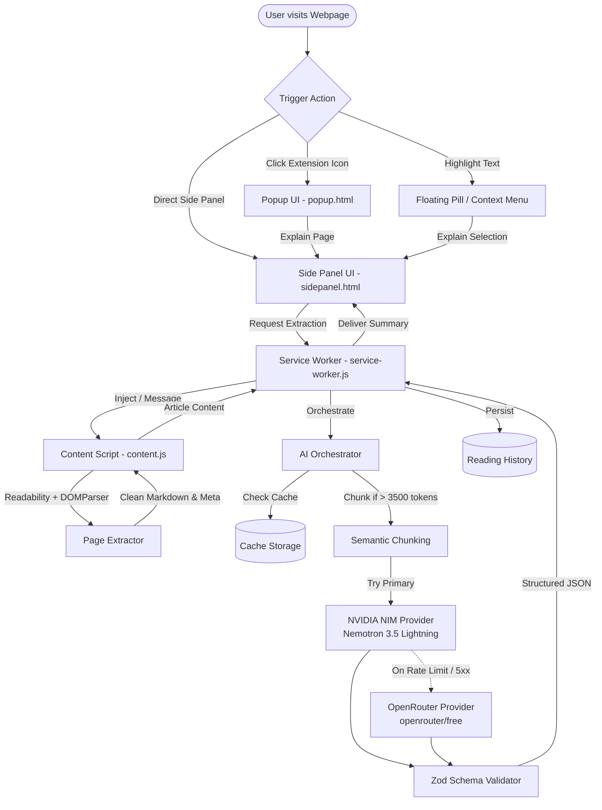

# Idiot Summary — Architecture & Technical Specifications

"Explain anything on the internet like I'm a complete beginner over a cup of chai."

## 1. System Overview

Idiot Summary is a Manifest V3 Chrome Extension engineered for deep webpage distillation and cognitive simplicity. It replaces raw reading overhead with a structured, jargon-free mental model.



---

## 2. Component Architecture

### A. Content Extraction Pipeline (`src/content/page-extractor.ts`)
- **Document Isolation**: The active DOM is cloned (`doc.cloneNode(true)`) prior to extraction so Mozilla Readability never mutates user-interactive DOM nodes or active form fields.
- **Noise Stripping**: Pre-cleans navigation elements, headers, footers, cookie banners (`.cookie-banner`, `#cookieConsent`), sticky ads, sidebars, dialogs, and SVG canvas trees.
- **Mozilla Readability**: Identifies the primary article container using algorithmic text-density scoring.
- **Fallback Semantic Containers**: If Readability returns sparse content (< 150 chars), it falls back sequentially through semantic selectors: `main`, `article`, `[role="main"]`, `#content`, `.docs-content`, `.markdown-body`.
- **Markdown Transformer (`htmlToCleanMarkdown`)**: Converts HTML nodes to structured markdown (headings `#`, lists `-` / `1.`, tables `|`, and relevant links `[text](url)`). Eliminates HTML bloat while preserving formatting context for the LLM.
- **Diagnostics & Error Detection**: Identifies unsupported protocols (`chrome://`, `about:blank`, Chrome Web Store restrictions) and paywall/login traps.

### B. Long-Content Management & Semantic Chunking (`src/ai/chunking.ts`)
- **Token Estimation**: Fast heuristic model (~3.8 characters per token, ~0.75 words per token).
- **Logical Sectioning**: Splits long documents at markdown heading boundaries (`#`, `##`, `###`) and paragraphs. Never slices arbitrarily mid-sentence or mid-word.
- **Context Overlap**: Maintains an overlap buffer (~200 tokens) between consecutive chunks to ensure continuity across section splits.
- **Map-Reduce Summarization**:
  1. If document tokens > 3,500: Splits into semantic sections.
  2. Map Step: Condenses each section into key facts, figures, arguments, and jargon definitions.
  3. Reduce Step: Synthesizes intermediate notes into the unified structured JSON response according to the active explanation mode.

### C. AI Provider Layer (`src/providers/`)
All providers adhere to the `BaseAIProvider` contract:
- **NVIDIA Provider (`src/providers/nvidia-provider.ts`)**:
  - Base URL: `https://integrate.api.nvidia.com/v1/chat/completions`
  - Default Model: `nvidia/nemotron-3.5-lightning-30b-a3b`
  - Temperature: 0.2 (low temperature for strict factual loyalty)
  - Exponential backoff retry logic (on HTTP 429, 500, 502, 503, 504).
  - Strict non-retry on HTTP 401/403 (invalid API key).
- **OpenRouter Provider (`src/providers/openrouter-provider.ts`)**:
  - Base URL: `https://openrouter.ai/api/v1/chat/completions`
  - Default Model: `openrouter/free` (and free tier models ending in `:free`)
  - Full request isolation with referer and title headers.
- **AI Orchestrator (`src/background/ai-orchestrator.ts`)**:
  - In-flight request deduplication via Promise caching.
  - Automatic fallback upon retryable provider exhaustion.
  - Records provenance (`model`, `provider`, `fallbackTriggered: boolean`).

### D. Prompt Engineering & Response Validation (`src/ai/`)
- **System Prompt**: Strictly grounds explanations to be clear, natural, and friendly (explaining like a knowledgeable friend over chai).
- **Prompt Injection Defense**:
  - Webpage content is quarantined within `<UNTRUSTED_WEBPAGE_CONTENT>` data boundaries.
  - Model is explicitly instructed that content inside the tags is data only and must never be interpreted as commands or prompt overrides.
- **Structured JSON Validation (`src/ai/response-validator.ts`)**:
  - Runtime validation using Zod (`StructuredSummarySchema`).
  - Robust JSON extractor handles code fences (```` ```json ````) and cleans trailing commas.
  - Safe field salvaging for incomplete or partial responses.

### E. Storage and Persistence (`src/storage/`)
- All persistence utilizes `chrome.storage.local`.
- Keys:
  - `idiot_summary_settings`: API keys, selected models, mode, length preference.
  - `idiot_summary_history`: Last 50 summarized articles with full parsed structured summaries.
  - `idiot_summary_cache_<hash>`: MD5/djb2 hash of `(url + fingerprint + mode + model)` to avoid redundant API consumption.

---

## 3. Extension Manifest V3 Compliance
- **Service Worker Lifecycle**: The background service worker (`service-worker.js`) is stateless and ephemeral; configuration and pending selections are stored in `chrome.storage.local`.
- **Side Panel Integration**: Side panel is declared via `"side_panel": { "default_path": "sidepanel.html" }` and triggered programmatically via `chrome.sidePanel.open({ tabId })`.
- **Content Script Isolation**: Bundled in `format: 'iife'` without dynamic ES imports to ensure universal execution across all web origins.
